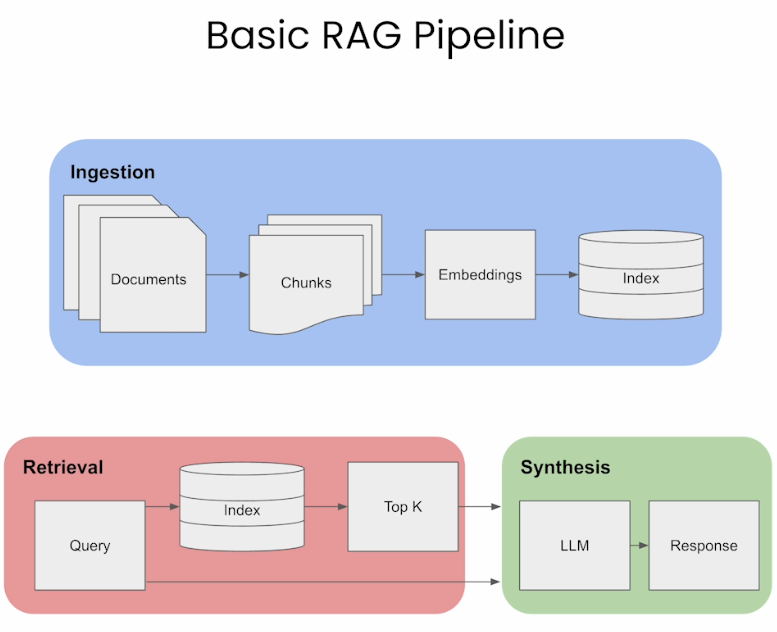
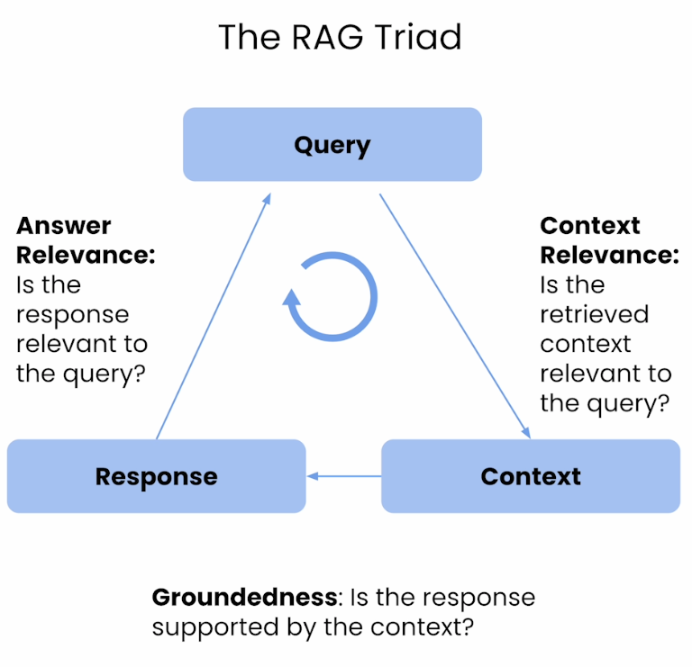
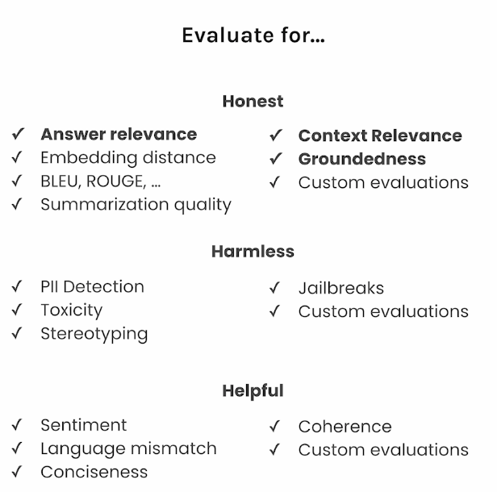
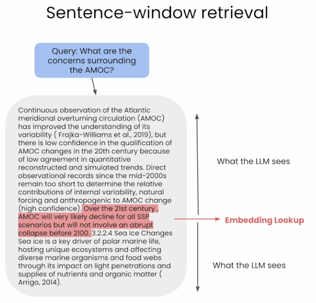
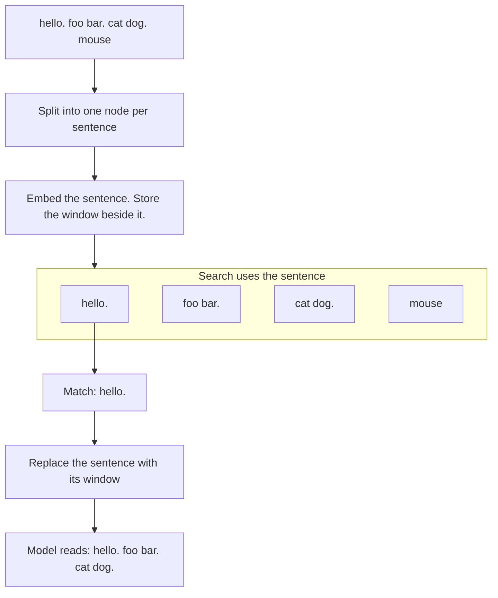
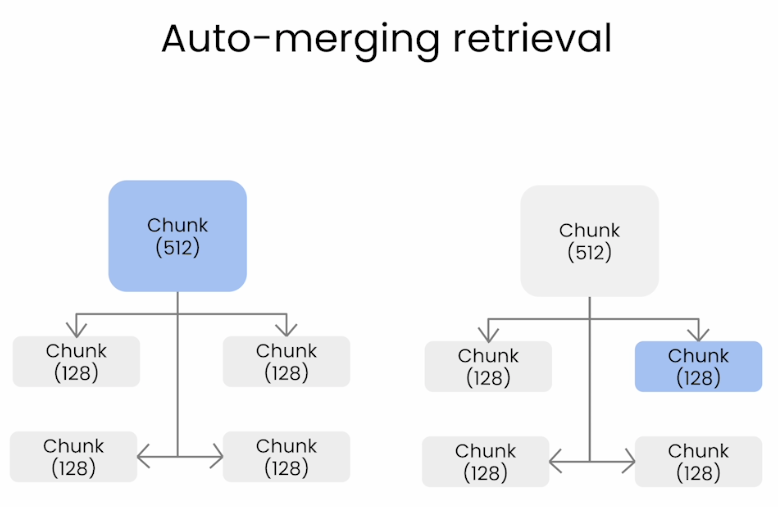
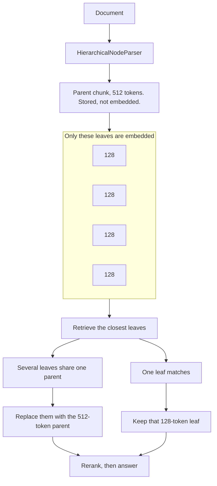

# Building and Evaluating Advanced RAG

<!-- Smaller fenced code in Cursor / VS Code markdown preview. github.com strips this block. -->
<style>
pre {
  font-size: 12px;
  line-height: 1.15;
  margin: 0.4em 0;
  padding: 0.5em 0.75em;
}
pre code,
pre code.hljs {
  font-size: inherit;
  line-height: inherit;
  display: block;
}
pre code > span {
  line-height: inherit;
}
</style>

Hands-on lessons for improving a retrieval-augmented generation pipeline past a single chunk size, then measuring whether the change helped.

You build a baseline RAG app over a short career-in-AI ebook, score it with the **RAG triad**, then compare **sentence-window retrieval** and **auto-merging retrieval** on the same questions. The course is taught by Jerry Liu (LlamaIndex) and Anupam Datta (TruEra).

**Course:** [Building and Evaluating Advanced RAG](https://learn.deeplearning.ai/courses/building-evaluating-advanced-rag)

## When Each Piece Is Worth It

A larger context window is useful when the retrieved text is the wrong *size* for the question. The triad is useful when you need to know which stage failed.

### Use sentence-window retrieval when

- The best match is a sentence, and the sentences around it hold the definition, example, or caveat the answer needs
- Embedding a whole paragraph pulls in neighboring topics and the match gets fuzzy
- You want retrieval to stay precise while the model still sees a readable passage

### Use auto-merging retrieval when

- The real answer is a section, and small chunks only recover pieces of it
- Several child chunks from the same parent keep matching, so the model should see the parent text once
- Documents have a natural hierarchy (section, paragraph, sentence)

### Use the RAG triad when

- You will change chunk size, top-k, or the retriever and need the same questions scored again
- A bad answer could come from the wrong chunks, from the model going beyond those chunks, or from an answer that misses the question
- You want a leaderboard of pipeline versions, not a single demo that looked fine

### Stay with baseline chunking when

- The corpus is small and one chunk already contains the full answer
- The question is a keyword or filter lookup a table can answer
- You have no fixed question set yet, so a score mostly measures the questions you happened to type

### Rule of thumb (from this course)

| Check | Question it answers | Typical fix |
|-------|---------------------|-------------|
| **Context relevance** | Did retrieval return text about this question? | Chunking, embeddings, top-k, sentence window, auto-merge |
| **Groundedness** | Is each claim in the answer supported by that text? | Prompt, context size, or a retriever that returns a coherent passage |
| **Answer relevance** | Does the answer address the question? | Prompt, or retrieval if the model never saw the right passage |

Low context relevance points at retrieval. Low groundedness with relevant context points at the model adding material. Low answer relevance means the response missed the question even if the chunks were fine.

## The Loop

```text
Same eval questions
  └─► Baseline: chunk, embed, retrieve, answer
       └─► Score the RAG triad (context, groundedness, answer)
            └─► Sentence window: embed sentences, give the model the surrounding window
                 └─► Score again
                      └─► Auto-merge: retrieve child chunks, replace them with the parent when enough children hit
                           └─► Score again and keep the version that wins on the failure you care about
```

## Project Structure

```
rag_eval/
├── README.md
├── L1-Advanced_RAG_Pipeline.ipynb   # Baseline, sentence window, and auto-merge
├── L2-RAG_Triad_of_metrics.ipynb    # Triad written out, scored on sentence window
├── L3-Sentence_window_retrieval.ipynb  # Window size 1 vs 3
├── L4-Auto-merging_Retrieval.ipynb  # Two-level vs three-level merge
├── utils.py                         # Triad feedbacks and the two index builders
├── rag-triad.png
├── auto-merging.png
├── basic-rag-pipeline.png
├── sentence-window.png
└── trulens-evals.png
```

L1 and L2 expect `eBook-How-to-Build-a-Career-in-AI.pdf` and `eval_questions.txt`. L3 and L4 expect the same PDF plus `generated_questions.text`. None of those data files are in this folder yet. The course’s four code lessons are:

| Lesson | Notebook | What you run |
|--------|----------|----------------|
| Advanced RAG pipeline | `L1-Advanced_RAG_Pipeline.ipynb` | Baseline, sentence-window, and auto-merge engines, each recorded in TruLens |
| RAG triad | `L2-RAG_Triad_of_metrics.ipynb` | The three feedback functions, written in the notebook and run on the sentence-window engine |
| Sentence-window retrieval | `L3-Sentence_window_retrieval.ipynb` | Build the sentence index and the window replacement yourself |
| Auto-merging retrieval | `L4-Auto-merging_Retrieval.ipynb` | A parent/child hierarchy and the auto-merging retriever |

The running document is an ebook on building a career in AI. L1 and L2 read `eval_questions.txt` (career, teamwork, networking, imposter syndrome, and similar). L1 also adds “What is the right AI job for me?”. L2 adds “How can I be successful in AI?”. L3 and L4 read `generated_questions.text`, which the notebook describes as the single question from the lecture. The course also offers five-question files, `generated_questions_01_05.text` through `generated_questions_21_24.text`, for a longer run. Those files are not here.

## Prerequisites

- Python and Jupyter
- A basic RAG pipeline: embeddings, a vector index, retrieve-then-answer
- An OpenAI API key

```bash
OPENAI_API_KEY=sk-...
```

LlamaIndex runs the RAG pipeline. `trulens_eval` records each query and builds the leaderboard. `utils.py` can also read `HUGGINGFACE_API_KEY`; L1 only sets `OPENAI_API_KEY`. Install the packages the notebook imports. The TruLens dashboard listens on <http://localhost:8501>.

Two different model families show up in these notebooks. The BGE models pick which chunks reach the generator. The triad scores come from separate OpenAI judge calls. Upgrading retrieval changes what the model sees. Upgrading judges changes how you measure quality. Those are different tuning problems.

### `BAAI/bge-small-en-v1.5` (embedding)

[Beijing Academy of AI](https://huggingface.co/BAAI/bge-small-en-v1.5) bi-encoder for English dense retrieval. At index time each chunk becomes a fixed-size vector. At query time the question is embedded the same way, and the vector index returns the nearest neighbors. Query and chunk are encoded separately, so chunk vectors can be precomputed. That keeps search fast and local, but similarity is only an approximation. L3 comments mention `BAAI/bge-large-en-v1.5` as a heavier upgrade. Better embeddings can improve context relevance and groundedness indirectly because retrieval improves. They do not change the TruLens judge functions.

L1 wires the embed model through `ServiceContext`. `ServiceContext` bundles the LLM, the embed model, and default chunking for every index built from it. The `local:` prefix tells LlamaIndex to load weights from Hugging Face on this machine instead of calling an embedding API.

```python
from llama_index import VectorStoreIndex, ServiceContext
from llama_index.llms import OpenAI

llm = OpenAI(model="gpt-3.5-turbo", temperature=0.1)
service_context = ServiceContext.from_defaults(
    llm=llm, embed_model="local:BAAI/bge-small-en-v1.5"
)
index = VectorStoreIndex.from_documents([document], service_context=service_context)
```

`from_documents` chunks the text, embeds each chunk with BGE small, and stores vectors for similarity search. The same `llm` also generates answers when you call `query_engine.query`.

### `BAAI/bge-reranker-base` (reranker)

[Cross-encoder](https://huggingface.co/BAAI/bge-reranker-base) that scores each query–passage pair in one forward pass. Vector search returns a wide set (`similarity_top_k` of 6 or 12). After sentence-window replacement or auto-merge, the reranker trims that list to `top_n` (2 in `utils.py`, 6 in parts of L4). Reranking costs more compute per query than bi-encoder search alone, but it is usually more accurate. The pattern here is cheap wide retrieve, then expensive narrow rerank.

L3 and `utils.py` attach reranking as **postprocessors** on the query engine. Postprocessors run after vector search returns nodes and before the LLM sees them. Order matters: window replacement runs first so the reranker scores full passages, not single sentences.

```python
from llama_index.indices.postprocessor import MetadataReplacementPostProcessor
from llama_index.indices.postprocessor import SentenceTransformerRerank

postproc = MetadataReplacementPostProcessor(target_metadata_key="window")
rerank = SentenceTransformerRerank(top_n=2, model="BAAI/bge-reranker-base")

sentence_window_engine = sentence_index.as_query_engine(
    similarity_top_k=6, node_postprocessors=[postproc, rerank]
)
```

`similarity_top_k=6` is the wide bi-encoder retrieve step. `top_n=2` keeps only the two cross-encoder scores the reranker likes best.

### Triad scores (judges, not BGE)

The quality columns on the leaderboard are LLM judgments, not embedding cosine scores. `get_prebuilt_trulens_recorder` wires Answer Relevance and Context Relevance through OpenAI `relevance_with_cot_reasons`, and Groundedness through `Groundedness(groundedness_provider=openai).groundedness_measure_with_cot_reasons`, all on `gpt-3.5-turbo` at temperature `0.1`. Generation uses the same model. Leaderboard `total_cost` counts OpenAI tokens for the query path; local BGE embed and rerank add no OpenAI line item. Judge calls are extra API usage and usually run after `query_engine.query`, so they are not in latency either. See Lesson 2 for the per-metric breakdown.

`utils.py` wires the triad with `Feedback`, `TruLlama`, `OpenAI`, and `Groundedness`. The full import and `Feedback` blocks live under Lesson 1 and Lesson 2.

### Alternatives when you outgrow the course defaults

| Goal | What to change | Notes |
|------|----------------|-------|
| Better retrieval | `bge-large-en-v1.5`, `bge-m3`, or API embeddings such as OpenAI `text-embedding-3-small` / `large` | Rebuild or reload indexes, then re-run the same eval questions and judges |
| Better reranking | `bge-reranker-v2-m3`, Cohere Rerank, or another cross-encoder | Swap `SentenceTransformerRerank` model name in the notebook or `utils.py` |
| More stable triad numbers | Stronger judge model in the same TruLens `Feedback` hooks | Smallest change from this course; higher cost per question |
| Cheaper context checks | Reranker or cross-encoder score of query vs each chunk | Aligns with how retrieval works; weaker on nuance than an LLM judge |
| Cheaper groundedness checks | NLI / entailment per answer sentence vs chunk | Good for regression tests; misses implicit support |
| Other eval harnesses | RAGAS, DeepEval, LlamaIndex evaluators | Metric names differ from the triad; do not compare raw numbers across frameworks |
| Gold-span or reference answers | BLEU, ROUGE, exact match | TruLens lists these under Honest; poor fit for open-ended career Q&A unless you build labeled references |

For comparing pipeline versions in this repo, keep the question list and judge definitions fixed while you change chunking, embeddings, or rerankers. If judges feel noisy, upgrade the judge model before swapping the triad for embedding-only scores.

## Lesson Overview

### Introduction

Why a RAG system needs both a better retriever and a way to measure it. One successful answer does not show whether retrieval or generation is the weak stage.

### Lesson 1: Advanced RAG Pipeline

**Notebook:** `L1-Advanced_RAG_Pipeline.ipynb`

**Notebook code** — Cells run top to bottom: baseline RAG, TruLens on the baseline, then sentence window and auto-merge through `utils.py`, with a database reset before each pipeline so leaderboard rows stay comparable.

**1. API key** — `utils.get_openai_api_key()` reads `OPENAI_API_KEY` from `.env` via `python-dotenv`. The notebooks set `openai.api_key` so both LlamaIndex and TruLens judges can call OpenAI.

```python
import utils
import os
import openai

openai.api_key = utils.get_openai_api_key()
```

**2. Baseline index** — Load the PDF as one `Document`, attach BGE small + `gpt-3.5-turbo`, build a default chunk index, and wrap it in a query engine. This is the “direct query” pipeline with no sentence window or auto-merge.

```python
from llama_index import SimpleDirectoryReader, Document, VectorStoreIndex, ServiceContext
from llama_index.llms import OpenAI

documents = SimpleDirectoryReader(
    input_files=["./eBook-How-to-Build-a-Career-in-AI.pdf"]
).load_data()
document = Document(text="\n\n".join([doc.text for doc in documents]))

llm = OpenAI(model="gpt-3.5-turbo", temperature=0.1)
service_context = ServiceContext.from_defaults(
    llm=llm, embed_model="local:BAAI/bge-small-en-v1.5"
)
index = VectorStoreIndex.from_documents([document], service_context=service_context)
query_engine = index.as_query_engine()
```

**3. Score the baseline** — `Tru()` connects to `sqlite:///default.sqlite`. `reset_database()` clears prior runs so this leaderboard row is only the direct engine. Inside the `with tru_recorder` block, each `query` is logged; TruLens schedules triad feedbacks after the answer returns.

```python
from trulens_eval import Tru
from utils import get_prebuilt_trulens_recorder

tru = Tru()
tru.reset_database()

tru_recorder = get_prebuilt_trulens_recorder(query_engine, app_id="Direct Query Engine")

with tru_recorder as recording:
    for question in eval_questions:
        response = query_engine.query(question)
```

**4. Advanced engines via `utils.py`** — L1 does not implement sentence window or auto-merge in the notebook. It imports builders from `utils.py`, gives each engine a distinct `app_id`, and calls `tru.reset_database()` again before each new engine so `get_leaderboard` shows one row per pipeline when you compare them.

```python
from utils import (
    build_sentence_window_index,
    get_sentence_window_query_engine,
    build_automerging_index,
    get_automerging_query_engine,
)

sentence_index = build_sentence_window_index(
    document,
    llm,
    embed_model="local:BAAI/bge-small-en-v1.5",
    save_dir="sentence_index",
)
sentence_window_engine = get_sentence_window_query_engine(sentence_index)

tru_recorder_sentence_window = get_prebuilt_trulens_recorder(
    sentence_window_engine,
    app_id="Sentence Window Query Engine",
)

merging_index = build_automerging_index(
    document,
    llm,
    embed_model="local:BAAI/bge-small-en-v1.5",
    save_dir="merging_index",
)
automerging_engine = get_automerging_query_engine(merging_index)
```

Each `build_*` call may persist under `sentence_index/` or `merging_index/` so a re-run can `load_index_from_storage` instead of re-embedding the ebook.

The baseline engine is this pipeline. Ingestion turns documents into chunks, embeds them, and stores the vectors. Retrieval embeds the query, takes the top matches from the index, and sends those chunks plus the query to the model.



L1 loads `eBook-How-to-Build-a-Career-in-AI.pdf`, joins the pages into one document, and runs the same `eval_questions.txt` list (plus “What is the right AI job for me?”) through three engines. Each engine is recorded with `get_prebuilt_trulens_recorder`, which already applies the RAG triad from `utils.py`. The notebook calls `tru.reset_database()` before each engine, so the leaderboard you open shows that run, not the previous ones.

| Engine | `app_id` | Built with |
|--------|----------|------------|
| Baseline vector index | `Direct Query Engine` | `VectorStoreIndex` in the notebook |
| Sentence window | `Sentence Window Query Engine` | `build_sentence_window_index`, saved under `sentence_index/` |
| Auto-merge | `Automerging Query Engine` | `build_automerging_index`, saved under `merging_index/` |

`tru.get_leaderboard(app_ids=[])` averages Answer Relevance, Groundedness, Context Relevance, latency, and total cost across the questions for the `app_id` values still in the database. L1 calls `tru.reset_database()` before each engine, so each saved leaderboard has one row. This run saved all three:

| `app_id` | Answer Relevance | Groundedness | Context Relevance | latency (s) | total cost |
|----------|------------------|--------------|-------------------|-------------|------------|
| Direct Query Engine | 0.95 | 0.880417 | 0.59 | 1.727273 | 0.003118 |
| Sentence Window Query Engine | 0.95 | 0.98 | 0.583333 | 2.545455 | 0.000875 |
| Automerging Query Engine | 0.855556 | 0.9 | 0.65 | 3.090909 | 0.000925 |

Direct query and sentence window tie on answer relevance at 0.95. Auto-merge is lower there, at 0.856, and leads context relevance at 0.65. Sentence window leads groundedness at 0.98. Direct query is the fastest. Sentence window is the cheapest. Direct query costs about three and a half times the sentence-window run. `records.head()` for the direct engine still shows one groundedness value as `NaN`; the leaderboard mean above was taken after those feedbacks finished.

`utils.py` holds the pieces later lessons open up:

- **Triad:** Answer Relevance, Context Relevance, and Groundedness, plus latency and cost on the leaderboard. How each number is produced is in Lesson 2.
- **Sentence window:** `SentenceWindowNodeParser` with `window_size=3` (three sentences on each side). The query engine retrieves 6 sentences, replaces each with its window, then reranks to 2 with `BAAI/bge-reranker-base`.
- **Auto-merge:** `HierarchicalNodeParser` chunk sizes `[2048, 512, 128]`. Only the 128-token leaves are embedded. `AutoMergingRetriever` replaces a cluster of leaves with their parent, then reranks the top 12 hits down to 2.

L1 calls those builders through `utils.py`. The triad recorder in that file matches:

- **`Feedback`** wraps a scoring function plus which fields from each trace to pass in (`.on_input_output()`, `.on(...)`, etc.).
- **Answer relevance** compares question text to final answer only; retrieved chunks are not inputs.
- **Context relevance** runs once per retrieved node text, then `np.mean` aggregates chunk scores (L1 uses `relevance_with_cot_reasons`, not L2’s `qs_relevance_with_cot_reasons`).
- **Groundedness** splits the answer into sentences and scores support against all source nodes, keeping each sentence’s max score before averaging.
- **`TruLlama`** instruments `query_engine.query` and attaches the feedback list under the given `app_id`.

```python
from trulens_eval import Feedback, TruLlama, OpenAI
from trulens_eval.feedback import Groundedness
import numpy as np

openai = OpenAI()

qa_relevance = (
    Feedback(openai.relevance_with_cot_reasons, name="Answer Relevance")
    .on_input_output()
)

qs_relevance = (
    Feedback(openai.relevance_with_cot_reasons, name="Context Relevance")
    .on_input()
    .on(TruLlama.select_source_nodes().node.text)
    .aggregate(np.mean)
)

grounded = Groundedness(groundedness_provider=openai)
groundedness = (
    Feedback(grounded.groundedness_measure_with_cot_reasons, name="Groundedness")
    .on(TruLlama.select_source_nodes().node.text)
    .on_output()
    .aggregate(grounded.grounded_statements_aggregator)
)

tru_recorder = TruLlama(query_engine, app_id=app_id, feedbacks=[qa_relevance, qs_relevance, groundedness])
```

L1 never edits this block; it only calls `get_prebuilt_trulens_recorder`. Lesson 2 rewrites the same ideas explicitly with `qs_relevance_with_cot_reasons` for context relevance.

**Focus:** Three pipelines, one question set. L1 keeps the feedback definitions and both index builders inside `utils.py`. L2 writes the triad in the notebook. L3 and L4 rebuild the retrievers.

---

### Lesson 2: RAG Triad of Metrics

**Notebook:** `L2-RAG_Triad_of_metrics.ipynb`

**Notebook code** — You reuse the sentence-window engine from `utils.py`, then define every `Feedback` in the notebook so you can see how TruLens attaches judges to retrieved nodes and answers.

**1. Setup and empty TruLens DB** — Same API key pattern as L1. L2 also silences noisy library warnings and resets SQLite so this lesson’s `App_1` run starts clean.

```python
import warnings

warnings.filterwarnings("ignore")

import utils
import openai

openai.api_key = utils.get_openai_api_key()

from trulens_eval import Tru

tru = Tru()
tru.reset_database()
```

**2. Sentence-window query engine** — L2 scores one fixed retriever while you learn the metrics. It rebuilds the ebook document and uses `utils.py` for the index and query engine (window size 3, rerank to 2) so the notebook cells focus on feedback definitions, not index plumbing.

```python
from utils import build_sentence_window_index, get_sentence_window_query_engine
from llama_index import SimpleDirectoryReader, Document
from llama_index.llms import OpenAI

documents = SimpleDirectoryReader(
    input_files=["./eBook-How-to-Build-a-Career-in-AI.pdf"]
).load_data()
document = Document(text="\n\n".join([doc.text for doc in documents]))

llm = OpenAI(model="gpt-3.5-turbo", temperature=0.1)
sentence_index = build_sentence_window_index(
    document,
    llm,
    embed_model="local:BAAI/bge-small-en-v1.5",
    save_dir="sentence_index",
)
sentence_window_engine = get_sentence_window_query_engine(sentence_index)
```

**3. Define and run the triad** — `nest_asyncio` lets TruLens run async judge calls inside Jupyter. `fOpenAI` is TruLens’s feedback provider (not the raw `openai` package). `context_selection` is a selector that pulls retrieved node text off each recorded query. L2’s context metric uses `qs_relevance_with_cot_reasons`: the chunk is treated as a **statement**, not as a pseudo-response. The eval loop matches L1: one `with tru_recorder` block over `eval_questions.txt`.

```python
import nest_asyncio

nest_asyncio.apply()

from trulens_eval import OpenAI as fOpenAI, Feedback, TruLlama
from trulens_eval.feedback import Groundedness
import numpy as np

provider = fOpenAI()
context_selection = TruLlama.select_source_nodes().node.text

f_qa_relevance = Feedback(
    provider.relevance_with_cot_reasons, name="Answer Relevance"
).on_input_output()

f_qs_relevance = (
    Feedback(provider.qs_relevance_with_cot_reasons, name="Context Relevance")
    .on_input()
    .on(context_selection)
    .aggregate(np.mean)
)

grounded = Groundedness(groundedness_provider=provider)
f_groundedness = (
    Feedback(grounded.groundedness_measure_with_cot_reasons, name="Groundedness")
    .on(context_selection)
    .on_output()
    .aggregate(grounded.grounded_statements_aggregator)
)

tru_recorder = TruLlama(
    sentence_window_engine,
    app_id="App_1",
    feedbacks=[f_qa_relevance, f_qs_relevance, f_groundedness],
)

with tru_recorder as recording:
    for question in eval_questions:
        response = sentence_window_engine.query(question)
```

After the loop, call `tru.get_leaderboard(app_ids=[])` and optionally `tru.get_records_and_feedback(app_ids=[])` to inspect per-question scores and `cot_reasons` text from the judges.

The three checks sit on the edges between the question, the retrieved text, and the answer:



`trulens_eval` supplies the metrics. `TruLlama` wraps the query engine, `Feedback` functions are the judges, and `Tru` writes each record to a local SQLite database. `get_leaderboard` averages a column for one `app_id`.

The library can score more than the RAG triad. A `Feedback` wraps whichever check you select. These notebooks use only the three bold honest checks: answer relevance, context relevance, and groundedness.



| Group | Checks |
|-------|--------|
| **Honest** | Answer relevance, context relevance, groundedness, embedding distance, BLEU, ROUGE, summarization quality, custom evaluations |
| **Harmless** | PII detection, toxicity, stereotyping, jailbreaks, custom evaluations |
| **Helpful** | Sentiment, language mismatch, conciseness, coherence, custom evaluations |

L2 rebuilds the sentence-window engine from `utils.py`, then defines the three checks in the notebook instead of calling `get_prebuilt_trulens_recorder`. It records that one engine as `app_id` `App_1`. A first context-relevance cell uses `qs_relevance`. The next cell replaces it with `qs_relevance_with_cot_reasons`, and that second function is the one on the recorder. `cot_reasons` means chain-of-thought reasons: the judge writes the criteria and the supporting evidence before the score.

`tru.get_leaderboard` averages each column across the questions in that run. The three quality scores are LLM judgments. Each `*_with_cot_reasons` call asks for that written reasoning and a score from 0 to 10, and TruLens divides by 10. A displayed 0.8 is an 8. Latency and total cost are measurements of the query, not judgments.

| Column | What is compared | How the number is produced |
|--------|------------------|----------------------------|
| **Answer Relevance** | Question and final answer | One `relevance_with_cot_reasons` call. The chunks are not an input. A response that covers the whole question scores 9–10. One that covers most of it scores 5–8. A confident false answer, or one that only seems relevant, scores 0. An “I don’t know” that fits the question still counts as relevant. |
| **Context Relevance** | Question and each retrieved chunk | Once per chunk, then `np.mean`. L2 uses `qs_relevance_with_cot_reasons`: the chunk is a statement, and the score rises as that statement covers more of the question. L1’s helper uses `relevance_with_cot_reasons` instead, with the chunk in the response slot. After reranking this is usually two chunks, and for the sentence-window engine that text is the expanded window. |
| **Groundedness** | Each answer sentence and the retrieved chunks | For each chunk, the judge scores information overlap of every answer sentence with that chunk, from 0 to 10. Sentences of 4 characters or fewer are skipped. A sentence keeps its highest score across chunks, then those best scores are averaged. One supporting chunk is enough. |
| **Latency** | The `query_engine.query` call | Wall-clock seconds for embedding, retrieval, reranking, and answer generation. The judge calls run afterward, so they are not included. |
| **Total cost** | OpenAI calls during that query | Prompt and completion tokens times the `gpt-3.5-turbo` price. Local `bge-small` embeddings and the `bge-reranker` add no OpenAI cost. Judge calls are not included. |

The saved L2 leaderboard is one row, `App_1`, over the 10 file questions plus “How can I be successful in AI?”:

| `app_id` | Answer Relevance | Groundedness | Context Relevance | latency (s) | total cost |
|----------|------------------|--------------|-------------------|-------------|------------|
| App_1 | 0.916667 | 0.825556 | 0.8 | 2.272727 | 0.000932 |

This is a sentence-window run only. Its context-relevance judge is the question-statement function, so the 0.8 is not the same check as the L1 sentence-window row.

**Focus:** Separate retrieval failures from generation failures before changing the index.

---

### Lesson 3: Sentence-Window Retrieval

**Notebook:** `L3-Sentence_window_retrieval.ipynb`

**Notebook code** — Early cells demo the parser on short strings; later cells build the full ebook index, copy helpers from `utils.py` with a configurable `sentence_window_size`, and eval both window sizes against `generated_questions.text`.

**1. Setup and document load** — Same env and warning pattern as L2/L4. You load the career ebook the same way as earlier lessons; L3 then replaces `utils.build_sentence_window_index` with explicit parser and postprocessor code.

```python
import warnings

warnings.filterwarnings("ignore")

import utils
import openai

openai.api_key = utils.get_openai_api_key()

from llama_index import SimpleDirectoryReader, Document
from llama_index.llms import OpenAI
```

**2. Sentence-window parser** — Each sentence becomes its own node. `window_size=3` stores up to three sentences on **each side** in metadata key `window`. `original_text` keeps the single sentence for debugging. Toy cells in the notebook print `nodes[i].text` versus `nodes[i].metadata["window"]`.

```python
from llama_index.node_parser import SentenceWindowNodeParser

node_parser = SentenceWindowNodeParser.from_defaults(
    window_size=3,
    window_metadata_key="window",
    original_text_metadata_key="original_text",
)
```

**3. Index + query engine** — `node_parser` is part of `ServiceContext`, so indexing embeds **sentences**, not paragraphs. After retrieval, `MetadataReplacementPostProcessor` overwrites each node’s text with its `window` metadata. The reranker then reads those wider passages when scoring query–chunk pairs.

```python
from llama_index import ServiceContext, VectorStoreIndex
from llama_index.indices.postprocessor import MetadataReplacementPostProcessor
from llama_index.indices.postprocessor import SentenceTransformerRerank

sentence_context = ServiceContext.from_defaults(
    llm=llm,
    embed_model="local:BAAI/bge-small-en-v1.5",
    node_parser=node_parser,
)
sentence_index = VectorStoreIndex.from_documents([document], service_context=sentence_context)

postproc = MetadataReplacementPostProcessor(target_metadata_key="window")
rerank = SentenceTransformerRerank(top_n=2, model="BAAI/bge-reranker-base")

sentence_window_engine = sentence_index.as_query_engine(
    similarity_top_k=6, node_postprocessors=[postproc, rerank]
)
```

**4. Compare window sizes 1 and 3** — The notebook copies the `build_sentence_window_index` / `get_sentence_window_query_engine` helpers locally so you can pass `sentence_window_size` and `save_dir` (`sentence_index_1` vs `sentence_index_3`). Eval uses `get_prebuilt_trulens_recorder` from `utils.py` (L1-style context relevance). `run_evals` is a thin loop: each question runs inside the recorder context so traces and feedbacks attach to the right `app_id`. `get_leaderboard` averages all apps still in the DB (both window sizes after a single `reset_database` before size 1).

```python
from trulens_eval import Tru
from utils import get_prebuilt_trulens_recorder

Tru().reset_database()

tru_recorder_1 = get_prebuilt_trulens_recorder(
    sentence_window_engine_1,
    app_id="sentence window engine 1",
)

def run_evals(eval_questions, tru_recorder, query_engine):
    for question in eval_questions:
        with tru_recorder as recording:
            response = query_engine.query(question)

run_evals(eval_questions, tru_recorder_1, sentence_window_engine_1)

tru = Tru()
tru.get_leaderboard(app_ids=[])
```

Sentence-window retrieval separates the text you search from the text you give the model:

- It **indexes individual sentences** so the system can find a precise match to your question.
- After finding a matching sentence, it **expands it into a window of nearby sentences** and gives that fuller passage to the language model.
- The idea is to get **precise retrieval without losing the surrounding context** needed for a good answer.

The highlighted sentence is the embedding lookup. The paragraph around it is what the model reads.





With `window_size=3`, the window stored on `hello.` is `hello. foo bar. cat dog.` The next sentence, `foo bar.`, keeps the whole line: `hello. foo bar. cat dog. mouse`.

L3 builds that parser in the notebook instead of calling the helper in `utils.py`. `SentenceWindowNodeParser` stores each sentence as the node text and the surrounding sentences under metadata key `window`. `MetadataReplacementPostProcessor` swaps the sentence for that window after retrieval. The query engine retrieves 6 sentences and reranks to 2 with `BAAI/bge-reranker-base`.

The toy sentence “hello. foo bar. cat dog. mouse” shows the window of size 3: the node `hello.` expands to `hello. foo bar. cat dog.`

The eval section then builds two indexes and scores them with `get_prebuilt_trulens_recorder`, so context relevance is the L1 prompt-response judge. Questions come from `generated_questions.text`.

| `app_id` | Window | Saved index |
|----------|--------|-------------|
| `sentence window engine 1` | 1 sentence on each side | `sentence_index_1/` |
| `sentence window engine 3` | 3 sentences on each side | `sentence_index_3/` |

`Tru().reset_database()` runs once, before the size-1 engine, so the leaderboard after the size-3 run contains both rows. The lecture file is one question, so each latency is that one query. A personal project needs about 20 questions. A business app needs 100 or more.

| `app_id` | Answer Relevance | Context Relevance | latency (s) | total cost |
|----------|------------------|-------------------|-------------|------------|
| `sentence window engine 1` | 1.0 | 0.3 | 4.0 | 0.000875 |
| `sentence window engine 3` | — | — | 4.0 | 0.001282 |

This leaderboard has no Groundedness column. Window size 3 had not finished Answer Relevance or Context Relevance when the cell ran, so those two cells are `NaN`. On the finished size-1 run, answer relevance is 1.0 and context relevance is 0.3. Both queries took 4.0 seconds. The size-3 query cost 0.001282, against 0.000875 for size 1.

**Focus:** Small units for the embedding search, a larger passage for the model.

---

### Lesson 4: Auto-Merging Retrieval

**Notebook:** `L4-Auto-merging_Retrieval.ipynb`

**Notebook code** — Build the hierarchy, try a demo query engine, define `get_automerging_query_engine` for eval, then compare two-layer and three-layer chunk trees as `app_0` and `app_1`.

**1. Setup** — API key and imports for loading the same ebook document as L1–L3.

```python
import warnings

warnings.filterwarnings("ignore")

import utils
import openai

openai.api_key = utils.get_openai_api_key()

from llama_index import SimpleDirectoryReader, Document
```

**2. Hierarchical index on leaves** — `chunk_sizes=[2048, 512, 128]` builds a three-level tree. Only `leaf_nodes` are embedded into the vector index. `storage_context.docstore.add_documents(nodes)` keeps **all** hierarchy levels in the docstore so `AutoMergingRetriever` can swap a cluster of leaves for a parent node text.

```python
from llama_index.node_parser import HierarchicalNodeParser, get_leaf_nodes
from llama_index import ServiceContext, VectorStoreIndex, StorageContext

node_parser = HierarchicalNodeParser.from_defaults(chunk_sizes=[2048, 512, 128])
nodes = node_parser.get_nodes_from_documents([document])
leaf_nodes = get_leaf_nodes(nodes)

merging_context = ServiceContext.from_defaults(
    llm=llm,
    embed_model="local:BAAI/bge-small-en-v1.5",
)
storage_context = StorageContext.from_defaults()
storage_context.docstore.add_documents(nodes)
automerging_index = VectorStoreIndex(
    leaf_nodes, storage_context=storage_context, service_context=merging_context
)
```

**3. Demo query engine (merge not wired)** — The notebook builds `AutoMergingRetriever` as `retriever` but passes `automerging_retriever` (the plain vector retriever) into `RetrieverQueryEngine.from_args`. Demo queries therefore skip parent merge; verbose merge logs appear only when the **eval** helper uses the merging retriever.

```python
from llama_index.indices.postprocessor import SentenceTransformerRerank
from llama_index.retrievers import AutoMergingRetriever
from llama_index.query_engine import RetrieverQueryEngine

automerging_retriever = automerging_index.as_retriever(similarity_top_k=12)

retriever = AutoMergingRetriever(
    automerging_retriever, automerging_index.storage_context, verbose=True
)

rerank = SentenceTransformerRerank(top_n=6, model="BAAI/bge-reranker-base")

auto_merging_engine = RetrieverQueryEngine.from_args(
    automerging_retriever, node_postprocessors=[rerank]
)
```

**4. Eval helper (merge wired correctly)** — `get_automerging_query_engine` passes the `AutoMergingRetriever` instance into `RetrieverQueryEngine`. Retrieval still starts at leaves (`similarity_top_k=12`); merges promote clusters to parents before rerank trims to `top_n=6`.

```python
def get_automerging_query_engine(
    automerging_index,
    similarity_top_k=12,
    rerank_top_n=6,
):
    base_retriever = automerging_index.as_retriever(similarity_top_k=similarity_top_k)
    retriever = AutoMergingRetriever(
        base_retriever, automerging_index.storage_context, verbose=True
    )
    rerank = SentenceTransformerRerank(
        top_n=rerank_top_n, model="BAAI/bge-reranker-base"
    )
    return RetrieverQueryEngine.from_args(retriever, node_postprocessors=[rerank])
```

**5. Score two hierarchies** — One `reset_database()` before `app_0` (`chunk_sizes=[2048, 512]`). A second index uses `[2048, 512, 128]` as `app_1` without resetting, so the final leaderboard lists both apps. Questions come from `generated_questions.text`. Re-run `get_leaderboard` after judges finish if any column is still `NaN`.

```python
from trulens_eval import Tru
from utils import get_prebuilt_trulens_recorder

def run_evals(eval_questions, tru_recorder, query_engine):
    for question in eval_questions:
        with tru_recorder as recording:
            response = query_engine.query(question)

Tru().reset_database()
tru_recorder = get_prebuilt_trulens_recorder(auto_merging_engine_0, app_id="app_0")
run_evals(eval_questions, tru_recorder, auto_merging_engine_0)
Tru().get_leaderboard(app_ids=[])
```

`utils.py` builds three levels, 2048, 512, and 128. The figure shows the bottom of that tree: a 512-token parent split into 128-token children. Retrieval starts at the leaves. On the left, enough children of one parent match, so those hits are replaced by the parent. On the right, a single child matches, so the model gets that 128-token chunk.





L4 builds the hierarchy in the notebook. `HierarchicalNodeParser` makes the tree, only the leaf nodes are embedded, and every node stays in the docstore so a leaf can be replaced by its parent. `AutoMergingRetriever` prints each merge (`Merging N nodes into parent node`). The eval engine retrieves 12 leaves and reranks to 6 with `BAAI/bge-reranker-base`.

The first demo query engine in the notebook passes the plain leaf retriever into `RetrieverQueryEngine`, so that one call does not merge. The helper `get_automerging_query_engine`, which the eval uses, does pass `AutoMergingRetriever`.

Both eval engines use `get_prebuilt_trulens_recorder` and `generated_questions.text`. The database is reset once, before the two-level run, so the later leaderboard still contains `app_0`.

| `app_id` | Chunk sizes | Answer Relevance | Groundedness | Context Relevance | latency (s) | total cost |
|----------|-------------|------------------|--------------|-------------------|-------------|------------|
| `app_0` | 2048, 512 | 0.995238 | 0.83977 | 0.443939 | 7.666667 | 0.003971 |
| `app_1` | 2048, 512, 128 | 0.980000 | — | — | 7.666667 | 0.002154 |

`app_1` had not finished groundedness or context relevance when that leaderboard was saved, so those two cells are `NaN`. On the finished two-level run, answer relevance is 0.995 and context relevance is 0.444.

**Focus:** Let the retriever decide the context size from how the hits cluster.

### Conclusion and Quiz

Recap of the two retrievers and the triad, then the course quiz.

## Learning Path

```text
L1  Baseline query engine vs sentence window, scored with helpers
 └─► L2  Write the RAG triad: context, groundedness, answer
      └─► L3  Sentence index and window replacement, then re-score
           └─► L4  Parent/child index and auto-merge, then re-score
```

## Technologies

| Area | Tools |
|------|--------|
| Orchestration | LlamaIndex query engines and node parsers |
| Evaluation | `trulens_eval`: triad feedbacks, `TruLlama` recorder, SQLite records, leaderboard, dashboard |
| Generation | OpenAI chat model |
| Embeddings | Local `BAAI/bge-small-en-v1.5` (bi-encoder retrieval) |
| Reranking | Local `BAAI/bge-reranker-base` (cross-encoder postprocessor) |
| Data | `eBook-How-to-Build-a-Career-in-AI.pdf`, `eval_questions.txt` (L1–L2), `generated_questions.text` (L3–L4). Not in this folder yet. |

## Suggested Workflow

1. Run L1 first. It compares the baseline, sentence window, and auto-merge through `utils.py`. L2 writes the triad and scores the sentence-window engine as `App_1`. L3 rebuilds sentence window and compares window sizes 1 and 3. L4 rebuilds auto-merge and compares two layers with three.
2. Keep the question list fixed. Add a question only when you also run it on every version you want to compare.
3. Give each pipeline its own TruLens `app_id` so the leaderboard stays readable.
4. Read the triad before picking a retriever. A sentence window helps when context relevance or groundedness is weak because the passage was the wrong size. Auto-merge helps when several small hits belong to one section.
5. Reset happens in the lesson notebooks (`tru.reset_database()`). Run it only when you mean to drop recorded feedback for that database.

## Resources

- [Course page](https://www.deeplearning.ai/courses/building-evaluating-advanced-rag)
- [LlamaIndex](https://www.llamaindex.ai/)
- [TruLens RAG triad](https://www.trulens.org/getting_started/core_concepts/rag_triad/)
- [TruLens sentence-window evaluation](https://www.trulens.org/cookbook/frameworks/llamaindex/llama_index_sentencewindow/)
